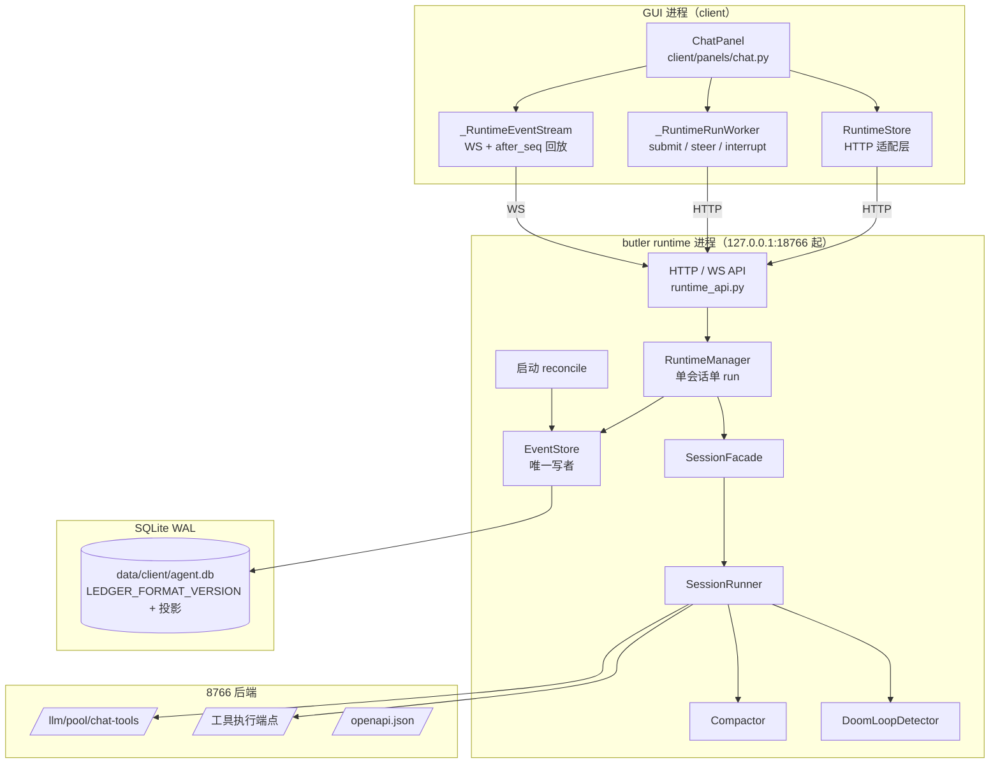

# v6-lite 对话引擎架构

本文档描述 client 端 v6-lite 对话引擎的核心组件、数据存储、与 GUI 面板的桥接机制。引擎的原始设计决策记录已归档并**随仓库跟踪**：`temp/planning_archive/sdd/chat-panel-v2/decisions.md`（D1-D47）与 `temp/planning_archive/sdd/chat-engine-safety-fixes/spec.md`；本档是给维护者的持久化摘要——看"当时为什么这么定"查归档，看"现在是什么行为"以代码为准。

> **范围说明**：v6-lite 是 v6 全量 13 文档的"砍范围开工"版本，EventStore 砍到 4 张核心表 + 后续安全修复阶段扩到 7 张表。详见 [ADR 0006](file:///<project_root>/docs/adr/0006-v6-lite-scope-cut.md)。

## 1. 概述

v6-lite 对话引擎是 LLM agent 运行时，负责：

- 接收用户输入 → 调用 LLM → 执行工具调用 → 写回会话事件
- SQLite 持久化所有对话内容（关机/崩溃可恢复）
- L2 上下文压缩（token 超 85% 阈值时摘要 + 保留最近 N 条原貌）
- 死循环检测（thinking_delta 尾重复时 mid-stream abort，会话中断**不重试**，详见 §6.1）
- 启动恢复（streaming/awaiting_tools 状态转 interrupted + 补缺失 tool_result）

引擎是**纯 Python 实现**（不依赖 Qt），实现位于 [lib/agent_runtime/](file:///<project_root>/lib/agent_runtime/)。自 2026-10 起它**不再运行在 GUI 进程里**：循环由独立的 butler runtime 进程持有，桌面面板、headless 作业、probe 都只是客户端（桌面面板经 HTTP/WS，见 §5）。

### 1.1 运行宿主（butler runtime）

| 项 | 值 / 入口 |
|---|---|
| 进程入口 | `python -m lib.agent_runtime.server --supervise`（手工启动脚本 `start_butler_runtime.bat`） |
| 首选端口 | 18766；被占用或落进 WinNAT 保留区时顺延，实际端口以声明为准 |
| 声明 | `data/runtime/butler_runtime.json`（`status` / `port` / `pid` / `format_version` / `api_base_url`），**不覆盖 8766 的 `server_port.json`** |
| 日志 | `data/runtime/butler_runtime.log` |
| 单实例 | 已有健康 runtime 时，第二次启动直接退出 0（日志 `already running`） |
| Host 守卫 | 只接受 `127.0.0.1` / `localhost` + 实际端口，其他 Host 返回 421 |
| 自愈 | `--supervise` 子进程非零退出按 1s→2s→5s→30s 退避重启；退出码 2（账本致命错误）不重启 |
| 客户端寻址 | [runtime_client.py](file:///<project_root>/lib/agent_runtime/runtime_client.py)：`PARCAE_RUNTIME_API` 环境变量优先，其次声明文件 |
| 开机自启 | **未做**（2026-10-21 用户裁决，远景） |

8766 后端仍提供 LLM 池、工具执行、审批、浏览器等能力，但**不再持有对话循环，也不再接受客户端直接写账本**；headless / judge / probe 由 8766 代理到 runtime。运行手册见 [operations-manual.md](file:///<project_root>/docs/operations-manual.md)。

## 2. 核心组件

所有组件位于 [lib/agent_runtime/](file:///<project_root>/lib/agent_runtime/) 目录。

| 组件 | 文件 | 类名 | 一句话职责 |
|------|------|------|------------|
| 会话运行器 | [runner.py](file:///<project_root>/lib/agent_runtime/runner.py) | `SessionRunner` | 对话主循环（纯逻辑，所有 I/O 通过 deps 注入）。持有 `has_attempted_reactive_compact`/`has_attempted_nudge` 防死循环标志位（retry 不重置），跨工具追踪 terminal。`run()` 是 wrapper，try/finally 确保 terminal 清理 + 捕获 CancelledError 写 `user_interrupted` transition |
| 事件存储 | [event_store.py](file:///<project_root>/lib/agent_runtime/event_store.py) | `EventStore` | SQLite 持久化对话事件。`threading.Lock` 串行化所有 DB 操作，WAL 模式，`check_same_thread=False` 跨线程访问。建表/迁移幂等（CREATE TABLE IF NOT EXISTS + ALTER TABLE ADD COLUMN） |
| 上下文压缩器 | [compactor.py](file:///<project_root>/lib/agent_runtime/compactor.py) | `Compactor` | L2 上下文压缩。`estimate_context_tokens()` 用「上一次调用的真实 `prompt_tokens` + 之后新增消息字符增量」估算，没锚点才退回 ~4 char/token 粗估；`should_compact()` 估算超 85% 阈值返回 True，**上限未知（keys.json 未填 `context_window`）时不判压缩**；`compact_with_result()` 调 LLM 生成摘要 + 保留最近 `tail_keep` 条原貌，返回 `CompactionResult`（含 `compaction_occurred` 标记防 fail-open 误判）。详见 §6.3 |
| 工具注册表 | [tool_registry.py](file:///<project_root>/lib/agent_runtime/tool_registry.py) | `ToolRegistry` | 从 server `/openapi.json` 物化工具 catalog，4 类分桶存储（builtin/core_mcp/parcae_sub/other_mcp/REST）。加载 `data/client/tool_specs.yaml` 说明书配置，`refresh()` fail-open 保留旧 catalog |
| LLM 网关 | [llm_pool_gateway.py](file:///<project_root>/lib/agent_runtime/llm_pool_gateway.py) | `LLMPoolGateway` | 经 server `/llm/pool/chat-tools` 调用 LLM。实现 `LLMGateway` 协议（`async def call`），不自建 provider client——key 轮换/重试/熔断由 server pool 处理。内置看门狗配置（`stream_idle_timeout_secs`/`stall_detection_window_secs`） |
| 启动恢复器 | [reconciler.py](file:///<project_root>/lib/agent_runtime/reconciler.py) | `reconcile()` 函数 | 扫描 `streaming/awaiting_tools` 状态 session → 标记 `interrupted`；扫描 `pending/running` tool_calls → 无对应 tool_result 时补 `is_error=true` 的 tool_result（yieldMissingToolResultBlocks，防 provider 400），终态按副作用档位区分（`pending→interrupted` / `running→unknown`，见 §6.2）；扫描未合并 streaming 事件 → 合并为完整 Message。幂等可重复运行 |
| 会话门面 | [facade.py](file:///<project_root>/lib/agent_runtime/facade.py) | `SessionFacade` | 纯 Python Facade 封装 SessionRunner。runtime 的 `RuntimeManager` 通过它调用引擎，核心逻辑不依赖 Qt。一个 facade 实例对应一次 `run()`。提供 `start/steer/interrupt/events` 接口，`_start_lock` 串行化 start 防并发，保存 `_runner_task` 供 interrupt 时 `task.cancel()` |
| 死循环检测器 | [doom_loop.py](file:///<project_root>/lib/agent_runtime/doom_loop.py) | `DoomLoopDetector` | thinking_delta 尾重复检测。滑动窗口 O(n²) 算法。命中后 mid-stream abort，会话直接中断**不重试**（详见 §6.1）。非线程安全（单 session 单线程使用） |

**辅助组件**：

| 组件 | 文件 | 类名 | 用途 |
|------|------|------|------|
| L0 大结果落盘 | [l0_artifact_store.py](file:///<project_root>/lib/agent_runtime/l0_artifact_store.py) | `L0ArtifactStore` | content > 8KB 阈值时落盘到 `<artifacts_dir>/<session_id>/<tool_call_id>.txt`，返回 preview+path 提示 |
| 模板存储 | [template_store.py](file:///<project_root>/lib/agent_runtime/template_store.py) | `Template` | 对话模板 CRUD（`data/chat_templates.json`）。字段：id/name/prompt/skills/created_at/updated_at |
| 内置工具执行器 | [builtin_tool_executor.py](file:///<project_root>/lib/agent_runtime/builtin_tool_executor.py) | `BuiltinToolExecutor` | 注册内置工具（file_read/write/edit/grep/glob/ls/delete + web_search/web_fetch + ask_user 等，**清单以 `lib/agent_runtime/builtin_tools/__init__.py` 的 `ALL_BUILTIN_TOOLS` 为准**），按 name 路由执行 |
| HTTP 工具执行器 | [http_client_tool_executor.py](file:///<project_root>/lib/agent_runtime/http_client_tool_executor.py) | `HttpClientToolExecutor` | 经 HTTP 调用 server 端点执行工具。`_denied_cache`：用户拒绝审批后同 (tool_name, args) 再次调用直接返回缓存 |
| 数据类型 | [types.py](file:///<project_root>/lib/agent_runtime/types.py) | `Message`/`Event`/`Session`/`LLMRequest`/`LLMResponse`/`ToolCall`/`ToolResult`/`ToolExecutor`/`LLMGateway`/`RunnerDeps`/`RunnerConfig`/`RunOutcome` | 引擎所有核心数据类型 + Protocol 定义 |

## 3. EventStore Schema

Schema 版本以 [event_store.py](file:///<project_root>/lib/agent_runtime/event_store.py) 的 `_SCHEMA_VERSION` 常量为准（当前 9）；完整定义在同文件的 `_SCHEMA_SQL`。

> **版本演进**：v5（chat-panel-v2 T01）→ v6（chat-engine-safety-fixes 加 events 表预留字段）→ v7（client_message_ids 幂等去重）→ v8（runner_state 持久化）→ v9（compactions 审计表）

**账本格式版本**（`LEDGER_FORMAT_VERSION`，当前 2）与 schema 版本分开：

- runtime 打开库前先检查 `format_version`；比代码更新 → 拒绝启动（退出码 2，supervisor 不重启），不会先写任何 schema；
- 旧库按迁移链逐步升级（v1→v2 建事件域 + 三投影）；迁移失败整批回滚，库保持迁移前状态；
- 备份必须用 SQLite backup API（WAL 库按文件 copy 会缺行）。

**三张投影**（`proj_stats` / `proj_turn_outline` / `proj_title`）：读路径（`SessionQuery`）优先读投影；投影缺失时报 `projection_missing`，用 `POST /admin/projections/rebuild` 从账本重建。事件写入时增量维护投影，rebuild 与增量走同一个 apply 函数。

### sessions 表（核心会话元数据）

| 字段 | 类型 | 说明 |
|------|------|------|
| `id` | TEXT PK | 会话 ID |
| `title` | TEXT | 会话标题 |
| `mode` | TEXT | 默认 `'dialogue'` |
| `status` | TEXT | 默认 `'idle'`（idle/streaming/awaiting_tools/interrupted/user_interrupted/idle 等状态机） |
| `created_at` / `updated_at` | REAL | 时间戳 |
| `prompt_index` | INTEGER | v6 预留：当前 prompt 序号 |
| `last_compaction_prompt_index` | INTEGER | v6 预留：上次压缩时的 prompt 序号 |
| `group_name` | TEXT | chat-panel-v2 T01：分组（NULL = 未分组） |
| `pinned` | INTEGER | chat-panel-v2 T01：置顶（0=否，1=是） |

### messages 表（消息流）

| 字段 | 类型 | 说明 |
|------|------|------|
| `id` | TEXT PK | 消息 ID |
| `session_id` | TEXT FK | 关联 sessions.id |
| `seq` | INTEGER | 会话内自增序号 |
| `role` | TEXT | user/assistant/tool/system |
| `content_json` | TEXT | 消息内容 JSON |
| `tool_call_id` | TEXT | tool 消息关联的 tool_call ID |
| `source` | TEXT | 默认 `'user'`（user/assistant/steer/queue/summary/synthetic 等） |
| `visible` | INTEGER | 默认 1（synthetic 消息 visible=0，不显示但参与上下文） |
| `created_at` | REAL | 时间戳 |
| `tool_calls_json` | TEXT | assistant 携带的 tool_calls（OpenAI 格式） |
| `thinking_json` | TEXT | LLM thinking 内容 |
| `model` | TEXT | assistant 消息的模型名（chat-panel-v2 T01） |

### 其他 5 张表（v6-v9 安全修复阶段新增）

| 表 | 用途 | 引入版本 |
|----|------|----------|
| `events` | append-only 事件流（含 `prompt_index`/`invalidated_seq` v6 预留字段） | v6 |
| `tool_calls` | 副作用前先落 durable record（`pending` → `running` → 终态 `completed`/`failed`/`interrupted`/`unknown`；终态不可原地改写，见 §6.2） | v6 |
| `usage` | 每次 LLM 调用的 token usage 持久化（失败/断流也落库） | v6 |
| `client_message_ids` | 客户端幂等去重 | v7 |
| `runner_state` | runner 关键状态持久化（每 session 一行，含 `has_attempted_reactive_compact`） | v8 |
| `compactions` | 压缩历史审计 | v9 |

## 4. chat-panel-v2 关键设计

实现位于 [client/panels/chat.py](file:///<project_root>/client/panels/chat.py)。逐条设计决策见归档 `temp/planning_archive/sdd/chat-panel-v2/decisions.md`（D1-D47）。

### 开始页 `_StartPage`

首次启动 / 点新对话 / 删除当前会话后右侧主区显示。包含输入框（Ctrl+Enter 发送，Enter 换行）+ 模板 tab（默认空白 + "+" 新建）+ 最近 5 对话。`send_requested` 信号携带 text / template_skills[] / group_name。

### 模板管理 `_TemplateManagerPanel`

左侧列表 + 右侧编辑区（name / prompt / skills 复选框）。失焦自动保存（focusOutEvent / editingFinished 信号触发 `template_update`）。数据层复用 `template_store` CRUD。

### 侧边栏

元界面区（新对话/模板管理，固定顶部）+ 置顶区（按 updated_at 倒序）+ 分组列表（UTF-8 顺序排序组名，组内 updated_at 倒序）+ 实时按标题过滤搜索框（D15）。`QTimer` 2 秒低频刷新会话列表。三点菜单：删除（确认对话框）/重命名（行内编辑）/移动到分组/置顶-取消置顶/导出（QFileDialog）。

### 消息时间线块结构

`_MessageTimeline` 容器管理 seq 顺序追加，每段独立块类。基类 `_TimelineBlock` 派生的块类型如下（子类清单以 [client/panels/chat.py](file:///<project_root>/client/panels/chat.py) 为准）：

| 块类 | 用途 |
|------|------|
| `_UserBubble` | user / steer / queue 消息。user 右对齐 ACCENT_WASH bubble；steer 右对齐 WARNING 色"用户引导"标记；queue 右对齐 INFO 色"排队中"标记 |
| `_AssistantTextBlock` | assistant 文本回复块（左对齐无 bubble，setMarkdown 渲染） |
| `_ThinkingBlock` | LLM thinking 内容块（默认折叠，展开无滚动） |
| `_ToolCallBlock` | 工具调用折叠卡（默认折叠为单行 tool 名 + 状态点，展开后三部分：原请求 + 原结果 + 格式解析） |
| `_SystemBlock` | 系统消息块 |
| `_AskUserBlock` | `ask_user` 提问卡：单选（QRadioButton 互斥）/ 多选（QCheckBox）/ 自由输入（QLineEdit）三态，两个出口「提交回答」与「跳过，你自己定」。答完即锁；超时或中断后由事件层转失效态（写明"问题未回答"，不伪装成用户拒绝） |

### 对话控制三模式（D34）

runner 运行中输入框上方显示 3 tab，单一发送键按当前 tab 触发：

| 模式 | 常量 | 行为 |
|------|------|------|
| 发送 | `MODE_SEND` | runner 中断 + 已生成 assistant 文本保留为中断消息 + start 新 run |
| 队列 | `MODE_QUEUE` | 存排队区单条（D36a 超出禁用 tab），run 完成后自动 start |
| 引导 | `MODE_STEER` | runtime `POST /steer` 注入消息不打断当前 run，引导消息以 user 样式 + 小字标记展示 |

空闲态只显示"发送"tab；运行态显示全部 3 tab，默认切到"引导"tab。排队区消息有编辑按钮，点击取消排队并把内容追加到输入框末尾。

## 5. ChatPanel 与 runtime 的桥接

文件：[client/panels/chat.py](file:///<project_root>/client/panels/chat.py)。面板不再持有循环、也不打开 SQLite：

- **读**：`RuntimeStore`（[client/core/runtime_store.py](file:///<project_root>/client/core/runtime_store.py)）把 runtime HTTP 包装成与 `EventStore` 同形的异步方法（`list_sessions` / `load_messages` / `load_tool_calls` / `load_streaming_events` / `get_session` …），所以时间线渲染代码不用改。
- **写**：标题 / 置顶 / 分组 / 删除会话 / 删除消息 / 分支走 `PATCH`·`DELETE`·`POST /sessions/{id}/branch`；排队消息走 `POST /sessions/{id}/queue`（客户端唯一允许的 messages 写入）。
- **运行**：`_RuntimeRunWorker(QThread)` 只做三件事——`POST /submit`、按需 `POST /steer|/interrupt`、等会话到终态；它不创建 EventStore、不跑 SessionRunner。submit 可带 `model_override` / `template_skills` / `max_iterations` / `context_window`。
- **增量**：`_RuntimeEventStream(QThread)` 跟随当前会话连 `ws://…/ws?session_id=…&after_seq=…`，断线按最后收到的 `seq` 续传；`streaming_text_delta` / `streaming_thinking_delta` 直接落时间线，`ask_user_*` 走卡片，其余持久事件合并触发一次状态刷新。
- **轮询降级**：WS 在线时 `_poll_timer` 降到 1s（只兜底）；WS 断开才回到打字机档位（30ms/16ms/关闭）。重连期间最终消息仍由轮询补齐。

### ask_user：runtime 发事件，卡片回 POST

renderer 在主线程；等待逻辑在 runtime，不在 GUI 进程：

1. runtime 的 `RuntimeAskUserProvider` 写 `ask_user_request` 事件（`rid` + `questions`），然后等 `POST /ask_user/{rid}` 或 WS 回帧；
2. 面板收到事件 → `_AskUserBlock` 上屏；提交/跳过 → `POST /ask_user/{rid}`（后台线程），`ask_user_resolved` 事件到达后卡片作废；
3. 等待时长只由 `[runner] ask_user_timeout_secs` 决定（0 或缺失 = 永不超时），工具入参里没有 timeout 这一格——agent 传不了"1 秒算你没答"；
4. **没有 WS 客户端时直接 `no_host`**（fail-closed），不写事件也不等待；WS 回放的历史 `ask_user_request` 只在会话仍活跃时上屏，避免出现无人能答的卡片。

五种 outcome（`answered` / `timeout` / `skipped` / `cancelled` / `no_host`）的映射见 [builtin_tools/ask_user.py](file:///<project_root>/lib/agent_runtime/builtin_tools/ask_user.py)：`timeout` 与"用户不同意"必须是两条能分开的文本。

### 关前端不中断会话

`MainWindow.closeEvent` 调 `ChatPanel.detach_active_session()`：断开 WS、停止本地 worker 等待、作废本地卡片，**不向 runtime 发 interrupt、也不改 session.status**。循环继续跑到终态，重开面板按历史回放（spec §3）。用户主动中断走「中断」按钮 → `POST /interrupt`。

### 关键调用代码位置

| 操作 | 位置 |
|------|------|
| 面板读账本 | `RuntimeStore` 上同形方法；`_safe_read` 同步执行 |
| 提交一轮对话 | `_RuntimeRunWorker._run_async` → `RuntimeClient.submit` |
| 引导 / 中断 | `_RuntimeRunWorker.steer/interrupt` → `/steer`、`/interrupt` |
| 增量事件 | `_RuntimeEventStream` → `_on_runtime_event` |
| `template_skills` 注入 system prompt | submit 的 `template_skills`，runtime 传给 `SessionFacade.start` |
| 关闭窗口 | `detach_active_session()`（只断开，不发中断） |

## 6. 关键运行时机制

### 6.1 DoomLoopDetector 触发条件

文件：[doom_loop.py](file:///<project_root>/lib/agent_runtime/doom_loop.py)

**配置**（`DoomLoopConfig`）：

| 字段 | 默认值 | 说明 |
|------|--------|------|
| `enabled` | True | 总开关 |
| `tail_size` | 2000 | 检测窗口大小（最近 N 字符） |
| `min_repeat_len` | 50 | 最小重复单元长度 |
| `repeat_threshold` | 3 | 连续重复次数阈值 |
| `max_retries` / `backoff_*` | — | **已不使用**（B1 重构后不重试，字段仅为兼容保留） |

**检测范围**：仅 `thinking_delta` 流的尾重复（不扩展到 `text_delta` / 工具指纹）。

**触发算法**：维护 `tail_window` 字符串，tail 长度 ≥ `min_repeat_len * repeat_threshold` 时启动 O(n²) 滑动窗口检测，从大 L 开始尝试找到第一个匹配的重复单元。

**命中后处理（B1 重构后，不重试）**：mid-stream abort → 已收到的 partial text 落库为 `source="partial"` 消息 → streaming 事件标 `invalidated` → 写一条**用户可见但 LLM 不可见**的系统警告（`source="system_warning"`，建议换种问法或新开对话）→ 写 `transition(doom_loop_detected)` 事件 → 会话状态置 `interrupted`，`RunOutcome.stop_reason="doom_loop_detected"`。用户看到警告后自行决定下一步（用户消息即隐式 nudge）。

### 6.2 Reconciler 启动恢复

文件：[reconciler.py](file:///<project_root>/lib/agent_runtime/reconciler.py)

runtime 启动时（FastAPI lifespan，早于对外 ready）调用 `reconcile()`——此时本进程还没有任何活跃 run，不会误伤在跑的会话。GUI **不再自己 reconcile**，只通过 `GET /admin/recovery` 取本次启动恢复了哪些会话来显示 banner：

1. 扫描 `streaming/awaiting_tools` 状态 session → 标记 `interrupted`
   - **后端进程持有的会话不在回收范围**：`headless-` / `headless-judge-` 前缀的会话写在
     同一个 `agent.db` 里但归后端管，等审批可以静默超过判活阈值（阈值 60 秒，审批等待上限
     见 `http_client_tool_executor` 的 `DEFAULT_APPROVAL_TIMEOUT_S`），GUI 若照旧判活就会把
     还活着的会话标成 `interrupted`。前缀真源在 `lib/agent_runtime/types.py` 的
     `SERVER_SIDE_SESSION_PREFIXES`，`headless_runner` 复用同一常量。
2. 扫描 `pending/running` tool_calls → 无对应 tool_result 时补 `is_error=true` 的 tool_result（防 provider 400）
   - **区分"确定没执行"与"不知道执行没执行"**：`pending` → `interrupted`（还没开始跑，重跑安全）；
     `running` → `unknown`（副作用可能已经落地）。补的 tool_result 文案按 `lib/side_effect_tier`
     的静态分档决定口径：外部不可逆档明写"禁止直接重做，先查证"，只读/本地可逆档才说可以重试。
     旧实现对两者一律写 "Please retry or choose a different approach"。
3. 扫描未合并 streaming 事件 → 合并为完整 Message → 标记 `invalidated`

幂等可重复运行。详见 [ADR 0012](file:///<project_root>/docs/adr/0012-session-manager-in-memory-only.md)。

#### 终态不可回写（`unknown-outcome-evidence` T01）

`tool_calls.status` 的四个终态（`completed` / `failed` / `interrupted` / `unknown`）不可被原地改写：
`EventStore.update_tool_call_status()` 检测到当前已是终态时拒绝写入，改为追加一条
`tool_call_status_write_rejected` 审计事件并返回 `False`。要修正已落定的事实只能追加新事件——
这样即使有旧进程晚一步复活，也盖不掉新事实。同值且不带时间戳的写入按幂等 no-op 处理，不产生审计噪音。
被拒次数可由 `EventStore.tool_call_outcome_summary()` 读出（无人值守 judge 用它当证据）。

### 6.3 Compactor 压缩策略

文件：[compactor.py](file:///<project_root>/lib/agent_runtime/compactor.py)

- `estimate_context_tokens(messages, anchor)`：估算"下一次请求有多大"，两种口径写在
  `ContextEstimate.basis` 里（不假装一样准）——
  - `usage_anchor+delta`：**上一次调用的真实 `prompt_tokens`（`usage` 表）+ 之后新增消息的
    ~4 char/token 增量**。为什么必须有锚点：字符估算量不到 system prompt 与工具 schema，
    实测同一会话真实峰值 97090 而整会话字符估算只 27196（差 ~3.6 倍）。
  - `chars_only`：没有可用锚点（首轮 / `prompt_tokens=0` / 锚点比一次压缩更早 ⇒ 算的是
    压缩前那份上下文）时退回纯字符估算。
  - 增量口径是 `created_at >= 锚点时刻`（不是 `>`）：本机时钟粒度 ~15.6ms 一个 tick，
    连着两次写常拿到同一个 float，用 `>` 会把"其实更新"的消息静默丢掉——低估正是本次要修的失效方向。
- `should_compact(messages, anchor)`：估算超 `max_context_tokens * 85%` 才返回 True；
  **`max_context_tokens <= 0` 表示"上限未知"，直接返回 False 并打一行说明**——不用编出来的
  默认值判压缩（旧默认 32000 低于实测跑通过的 97090）。上限的来源是 keys.json 的 model 级
  `context_window`，经 `/llm/pool/models` 透出，由 chat 面板按所选 model 随 submit 传
  `context_window`，runtime 用它构造该轮的 `Compactor`（见 `docs/llm-pool.md`）。
- ✅ **主动触发已接线（2026-10-10，`wip_chat_3directions` 最后一格）**：主循环在
  `_build_request` 前调 `_maybe_proactive_compact()`——用与上面同一套判据估算，超阈值就
  `compact_with_result()` → `replace_messages()` → 写 `transition(proactive_compact)` →
  `continue` 重建请求。与 413 的 reactive 压缩**互补**（reactive 撞墙后补救，这是撞墙前预防），
  两条路径共用 `compactions` 表记录（`_record_compaction`）。护栏：上限未知 / 未注入 compactor
  ⇒ 恒不压；每 run 主动压缩上限 `MAX_PROACTIVE_COMPACTIONS=3`（防"压了还超"死循环，撞上限后
  照常调 LLM）；compactor 抛异常或没真压（`compaction_occurred=False`）一律放行不阻断。
  ⚠️ 接线前提是 keys.json 的 `context_window` **得先有值**（否则判据恒 False、接线等于 no-op）——
  2026-10-10 已给 33 条 model 补齐，`GET /llm/pool/models` 实测 **14/14 条 llm-scope 在用模型带值**
  （此前全 0）。`runner._log_context_estimate` 的 `context estimate: ... anchor=… delta=… limit=…`
  仍是观测行（仅观测、不改调度）。
- `compact_with_result()`：调 LLM 生成摘要 + 保留最近 `tail_keep` 条原貌
- `CompactionResult.compaction_occurred` 标记防 fail-open 误判
- `RunnerDeps.doom_loop_config` 注入时创建 detector，None 时禁用
- `has_attempted_reactive_compact` 标志位 retry 不重置（防死循环）；主动侧另有
  每 run 计数 `_proactive_compact_count`（上限 `MAX_PROACTIVE_COMPACTIONS`）

### 6.4 「结果未知」在活路径上怎么产生

文件：[runner.py](file:///<project_root>/lib/agent_runtime/runner.py) + [http_client_tool_executor.py](file:///<project_root>/lib/agent_runtime/http_client_tool_executor.py)

§6.2 处理的是"重启后才发现的悬空 tool_call"。活路径上也要能区分"确定失败"与"不知道成没成"：

- 执行器在**请求阶段超时**（请求可能已经发到后端并被执行）时置 `ToolResult.outcome_unknown = True`；
- **等审批超时不置位**——审批没通过，请求根本没发出去，这是可证明的"未执行"，不该记成 unknown；
- `runner._resolve_terminal_status()` 据此把状态写成 `unknown`，并在回填给模型的 tool_result 文案尾部附档位提示（`lib/side_effect_tier` 判外部不可逆 → "先查证再决定，别直接重做"；只读/本地可逆 → "可以重试"）。

档位表是**静态的**，模型没有裁量权：`lib/side_effect_tier.py` 用精确名单 + 前缀（`screen_` / `desktop_` / `vm_` / `git_` / `net_` 等）分类，**未命中一律按保守档处理**。workspace 可在自己的 `manifest.toml` 用 `[side_effect_tier]` 段覆盖具体工具的档位（带 mtime 缓存）。

### 6.5 覆盖写之前的可回滚副本

文件：[_write_backup.py](file:///<project_root>/lib/agent_runtime/builtin_tools/_write_backup.py)

`file_write` / `file_edit` 的旧注释写着"有副作用但可逆"——实测不成立：覆盖已存在文件时旧内容当场消失，项目里没有任何副本。现在覆盖前把旧字节复制到 `temp/write_backups/`（按原文件绝对路径的 sha256 前缀归组，`<tag>.origin.txt` 记原路径），并把副本路径写进工具结果，让人和模型都看得见退路。范围克制：只在目标文件**已存在**时备份；备份失败不阻断写入（副本是保险，不是闸门）；按 `BACKUP_RETENTION_DAYS` 保留、单文件最多 `MAX_COPIES_PER_FILE` 份，进程内只扫一次。

## 7. ADR 引用

| ADR | 标题 | 核心决策 |
|-----|------|----------|
| [ADR 0006](file:///<project_root>/docs/adr/0006-v6-lite-scope-cut.md) | v6-lite 砍范围开工 | v6 全量 13 文档降级为参考库，EventStore 砍到 4 表，6 周垂直切片替代 P0-P6 |
| [ADR 0012](file:///<project_root>/docs/adr/0012-session-manager-in-memory-only.md) | 会话管理层纯内存不持久化 | SessionManager 授权状态纯内存，后端重启重置为 NO_PERMISSION（防幽灵授权） |
| [ADR 0016](file:///<project_root>/docs/adr/0016-chat-engine-bookkeeping-only.md) | chat 引擎只记账不控制 | 删 cost 字段（dead field），新增 `total_tokens` 仅记账，`wall_clock_budget_secs` 是唯一预算控制 |
| [ADR 0045](file:///<project_root>/docs/adr/0045-context-estimate-anchor-and-unknown-limit.md) | 压缩判据以真实 `prompt_tokens` 为锚点 | 上限未知（keys.json 没填 `context_window`）就不判压缩，不用编造的默认值比；见 §6.3 |
| [ADR 0046](file:///<project_root>/docs/adr/0046-ask-user-blocking-bridge-and-timeout-ownership.md) | ask_user 走 worker 同步阻塞桥（**桥实现已被 ADR 0048 取代**；时长归属与 outcome 文案仍有效） | 等待时长只归 `[runner] ask_user_timeout_secs`，"没回答"必须区别于"反对"；见 §5 |
| [ADR 0048](file:///<project_root>/docs/adr/0048-butler-runtime-single-writer-projection-ledger.md) | 对话循环迁出独立 butler runtime | 单一写者 + 版本化账本 + 读侧投影；桌面关前端只脱钩不中断会话；见 §1.1、§5 |

## 8. 架构图

## 9. 相关文档

- [ADR 0006 - v6-lite 砍范围开工](file:///<project_root>/docs/adr/0006-v6-lite-scope-cut.md)
- [ADR 0012 - 会话管理层纯内存不持久化](file:///<project_root>/docs/adr/0012-session-manager-in-memory-only.md)
- [ADR 0016 - chat 引擎只记账不控制](file:///<project_root>/docs/adr/0016-chat-engine-bookkeeping-only.md)
- [agent-guide.md](file:///<project_root>/docs/agent-guide.md) — 任务路由系统
- [todos-wip.md](file:///<project_root>/docs/todos-wip.md) — 待办与 WIP 系统
- `temp/planning_archive/sdd/chat-panel-v2/decisions.md` — chat-panel-v2 设计决策记录（D1-D47，随仓库跟踪的归档）
- `temp/planning_archive/sdd/chat-engine-safety-fixes/spec.md` — 引擎安全修复的 SDD spec（同目录另有 `design-decisions.md` / `tickets.md` / `checklist.md`）
