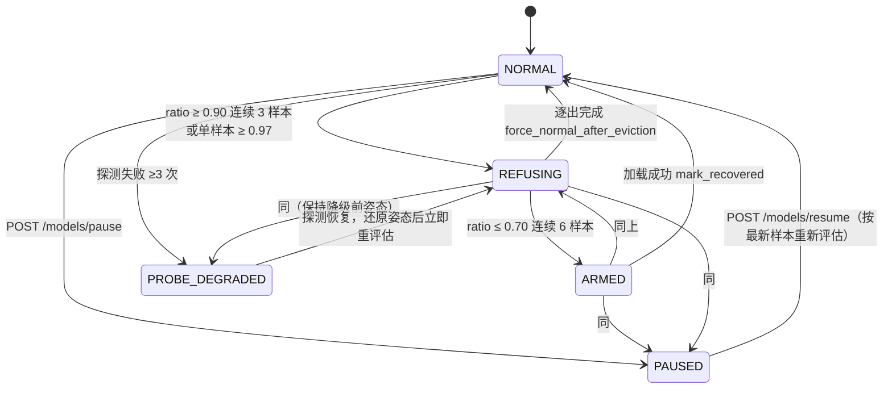

# OCR 全链路与状态机

> 读者：第一次碰 OCR 链路的人，或排查「OCR 突然 503 / 显存不释放 / 空闲到底会不会卸」的人。
> 本文只讲**现状与判据**；「为什么这样设计」在 [ADR-0030](adr/0030-model-lifecycle-manager-architecture-decisions.md)，
> 实测数据与踩坑在 `docs/environment-constraints.md`，模型权重路径在 `docs/model-paths.md`。

## 0. 五分钟心智模型

这套 OCR **不是一条流水线，而是三台独立的状态机叠在一起**。混在一起看最容易被绕晕，先分开：

| 状态机 | 回答的问题 | 真源 | 状态全集 |
|---|---|---|---|
| **A. 引擎生命周期** | 引擎对象在不在内存里？ | `server/ocr.py` `ModelManager` | cold / loading / ready / failed |
| **B. 资源压力** | 现在允许加载吗？该逐出谁？ | `server/model_manager/monitor.py` `PressureMonitor` | normal / refusing / armed / paused / probe_degraded |
| **C. 设备决策** | 这次加载用 GPU 还是 CPU？ | `server/ocr.py` `_decide_device()` | gpu / cpu（+ 降级迟滞态） |

三者的耦合点只有一个：**A 在每次真正加载前，先问 C（设备）再问 B（准入）**。除此之外互不知情。

```
请求 → A 快速路径（已加载直接返回）
     └ 未加载 → C 决策设备 → B 准入 → 拿 _load_lock → 复查 → 真加载
                                        ↑
                        拒绝时抛 ModelUnavailableError → 全局处理器 → 503 + 原因码
```

**关键认知：OCR 是唯一动态归属 GPU 的模型。** 其余 3 个（memory_embedding / guide_embedding / mindforge_searcher）
都是 CPU 且两个 embedding 默认钉住（不可逐出）。所以 GPU 压力一高，被选中的**永远先是 OCR**。

---

## 1. 接口层

### 1.1 `/ocr` 前缀：11 个路由

| 类别 | 端点 | 说明 |
|---|---|---|
| 识别（本地 PaddleOCR） | `POST /ocr/base64` | 表单，`image` 字段 |
| | `POST /ocr/file` | 表单上传 |
| | `POST /ocr/file/json` | JSON body，服务端路径 |
| | `POST /ocr/path/json` | JSON body，服务端路径（批量场景主力） |
| 识别（远程 VL） | `POST /ocr/vl/file` | 表单 |
| | `POST /ocr/vl/file/json` | JSON |
| | `POST /ocr/vl/path/json` | JSON |
| 状态 | `GET /ocr/status` | 引擎四态 + 设备 + 空闲回收倒计时 + `mlm_state` |
| 模型控制 | `POST /ocr/models/keep/json` | 常驻开关（写回 `restore_preload`） |
| | `POST /ocr/models/unload/json` | 手动卸载（走管理器 `manual_unload`） |
| | `POST /ocr/models/preload/json` | 预热 |

**VL 三件套不占本地 GPU**：走远程 provider（火山/OpenAI 兼容），`/ocr/models/unload/json` 传 `engine="vl"`
只会返回「远程 VL 无需卸载」的提示，是 no-op。它有自己的配额/降级逻辑，见 ADR-0043 / ADR-0044。

### 1.2 `/models` 前缀：控制面（6 个，独立于 `/ocr`）

`GET /models`（全模型报告）· `GET /models/pressure`（压力态 + 最近 10 条迁移事件）·
`POST /models/{id}/load|unload` · `POST /models/pause|resume`。

### 1.3 内部消费者（不经 HTTP，但走同一套状态机）

| 消费者 | 位置 | 备注 |
|---|---|---|
| `/screen/ocr` | `server/screen/routes.py` `screen_ocr` | 截图后直接 OCR，Computer Use 定位文字的首选 |
| 屏幕动作定位 | `server/screen/action_endpoints.py`、`server/screen/routes.py`、`server/screen/scroll_wait_analyze_endpoints.py` | 均调用 `server.ocr._do_ocr` / `_do_vl` |
| 活动追踪 | `server/activity_tracker/loop_actions.py` | 直接调 `_run_classic_ocr` |

这些路径**没有独立的模型管理逻辑**，全部落到 `get_ocr()`，所以准入/降级/卸载对它们同样生效。

---

## 2. 一次请求的完整链路

以 `POST /ocr/path/json` 为例（其它识别端点只是入参形式不同，末端汇流）：

```
读文件 → PIL 打开 → _split_long_image() 切片（max_height 默认 3000，重叠 200px）
      → 逐片 _run_classic_ocr()
             ├ models.get_ocr()            ← 状态机 A + C + B 全在这里
             ├ in_flight_scope() 计数      ← 卸载排空依赖它
             ├ ocr.predict(np.array)
             └ record_inference(ms)        ← 刷新 last_used_at（长推理保护）
      → 坐标换算（kx/ky/bx_ratio/by_ratio，见 config.toml `[ocr]`）→ 汇总
```

**长图切片的硬约束**：`max_height` 被 clamp 到 `≥ 2 × _SPLIT_OVERLAP`（=400px）。低于是死循环 ——
步进 `max_height - 200 ≤ 0` 时 `while y < h` 永不推进，pieces 无限增长（2026-09-13 code review 3-1 实测
`max_height=100/200/0/-1` 均触发）。

---

## 3. 状态机 A：引擎生命周期

### 3.1 四态及其可见字段

状态由三个变量组合而成：`_ocr_engine`、`_load_started_at`、`_last_error`。对外由 `/ocr/status` 的四个布尔体现：

| 状态 | 判据（代码原样） | `cold_start` | `loading` | `model_ready` | `failed` |
|---|---|---|---|---|---|
| **cold** 未加载 | `engine is None and _load_started_at is None` | ✅ | — | — | — |
| **loading** 加载中 | `engine is None and started 非 None and completed is None` | — | ✅ | — | — |
| **ready** 已就绪 | `engine is not None` | — | — | ✅ | — |
| **failed** 加载失败 | `engine is None and _last_error is not None` | — | — | — | ✅ |

⚠️ `failed` 态**不会自动消失**：`_reset_load_stats()` 只在卸载时调，失败后 `_load_started_at` 仍非 None，
所以下次成功加载前 `cold_start` 一直是 False、`failed` 一直是 True。看到 `failed=true` 而 `last_error` 是旧的，
先看作「上次没成功」而不是「现在正在坏」。

### 3.2 加载：`get_ocr()` 的 8 个动作，顺序有硬约束

1. **刷新 `_last_used_at`**（放最前面）。否则一次 20s 冷加载跑到第 10s 会被空闲回收判成「闲置」而卸载，
   加载完立刻又被卸 —— 白跑一遍。
2. **快速路径**：`_ocr_engine` 非 None 且 `not _unloading` → 直接返回。
3. **`_decide_device()`（状态机 C）**：必须**早于** `admit()`。原因：它把结果写进 `_active_device`，
   而 `OcrDriver.resource` 是动态 property 读这个值 —— 降级到 CPU 后准入才会走 cpu monitor 而不是被 gpu 拒绝。
4. **`manager.admit("ocr")`（状态机 B）**：REFUSING / 冷却 / 降级标记 → 抛 `ModelUnavailableError` → 503。
5. **进 `_load_lock`** → 复查 `_unloading`（拒绝）→ 复查 `_ocr_engine`（别人已经加载好了就返回）。
6. **锁内第二次 `admit()`**：等锁期间压力态可能已变（TOCTOU）。
7. **`_ensure_env()` → `_defer_modelscope_import()` → `_apply_pir_patch()` → `import paddleocr`**。
   顺序死规矩：
   - `_ensure_env()` 设 `PADDLEX_HOME` + `PADDLE_PDX_CACHE_HOME`，必须早于任何 paddlex 导入
     （`paddlex.utils.cache.CACHE_DIR` 是 import 时固化的模块级常量）；
   - `_defer_modelscope_import()` 必须早于 `import paddleocr`：paddlex 的 `official_models` 是模块级
     `import modelscope`，会把 **torch CUDA 栈（约 4GB private 提交）**整条拉进来。占位模块挡住后实测
     torch 顶层导入事件 0 条；
   - `_apply_pir_patch()` 关掉 `enable_new_ir`：PIR + oneDNN 会让 OCR 推理失败。
8. **锁内重新 `_decide_device()`** → `PaddleOCR(use_doc_unwarping=False, use_textline_orientation=True, lang="ch", device=...)`
   → 成功 `note_load_success("ocr")`，失败 `note_load_failure("ocr", ...)` 后原样上抛。

`use_doc_unwarping=False` **不是省性能**：UVDoc 会把普通截图几何扭曲，PaddleOCR 返回的框就在扭曲坐标系里，
屏幕点击/截图定位全部报废。

### 3.3 卸载：`unload_ocr()` 的 6 步

1. **进 `_load_lock`**，置 `_unloading=True`（此后新获取一律拒绝，保证排空能收敛）。
   锁内复查引擎存在性 —— 若有加载在途，这里会阻塞到锁释放后读到已赋值的引擎，避免误报 `already_unloaded`
   导致显存不释放。
2. **排空 `_in_flight`**：0.2s 轮询，最长 10s。超时标 `forced=True` 但仍继续卸（在途 predict 持局部引用能跑完）。
3. **`del` + `gc.collect()`**。
4. **`_release_paddle_cache()`**：只在 `_active_device == "gpu"` **且** `"paddle" in sys.modules` 时才
   `empty_cache()`。CPU 路径上调它反而**初始化 CUDA 上下文**，实测 private 从 2131MB 涨到 2342MB（+211MB）。
5. **`_trim_working_set()`**：Windows `psapi.EmptyWorkingSet`，**默认关**（见 §7.3）。
6. **重置统计**：`_reset_load_stats()`、`_loaded_at=None`、`_last_used_at=None`、`_active_device` 复位为
   config 期望设备。**迟滞状态（`_fallback_active` / `_fallback_hold_until`）有意保留** ——
   防止卸载后 GPU 水位还在阈值附近时立刻跳回 GPU。

**线程归属硬规则**：本方法可达秒级阻塞，调用方必须走 `asyncio.to_thread`。在事件循环线程同步卸载会卡住整个后端。
管理器（逐出 / `manual_unload`）已遵守。

**卸载并不还 private 提交**：paddle 的 DLL 映像 + C++ 堆仍被进程持有（CPython 无卸载扩展模块机制）。
实测卸载后 private 约 1.5GB 不变、RSS 可降。要真还只能把 OCR 挪进子进程（B 方案，评估后暂缓）。

---

## 4. 状态机 B：资源压力

### 4.1 采样：不是子进程

数据源是常驻采样中枢 `server/resource_probe`（进程内 NVML 会话 + psutil），5s 一个周期。
WDDM 下**读不到 per-process 显存**，gpu 只能读整卡 `memory.used` —— 策略语义是「缓解整卡压力」，不是显存归因。

### 4.2 五态迁移



| 迁移 | 条件 | 代码 |
|---|---|---|
| NORMAL/ARMED → REFUSING | `ratio ≥ 0.90` 连续 3 个样本，**或**单样本 `≥ 0.97`（逃生门） | `_evaluate` |
| REFUSING → ARMED | `ratio ≤ 0.70` 连续 6 个样本 | `_evaluate` |
| ARMED → NORMAL | 加载成功 | `mark_recovered` |
| REFUSING → NORMAL | 逐出完成 | `force_normal_after_eviction` |
| 任意 → PAUSED | 手动 | `pause()`（采样继续，保护态冻结） |
| 连续 3 次探测失败 | → PROBE_DEGRADED，记住降级前姿态 | `on_probe_failure` |
| 探针不存在 | 姿态标记 `probe_absent`，**停在 NORMAL 且放行** | `_note_absent` |

**`probe_absent` 不是状态**：非 NVIDIA 卡 / psutil 缺失 / `[resource_probe] enabled=false` 时打这个标。
旧 `nvidia-smi` 子进程路线把「永远采不到首样本」算成 await，导致无卡机器上模型准入永久 503 —— 这是修回来的。

**PAUSED 的语义**：准入放行 + 停止逐出 + 采样继续。要强制加载就 `POST /models/pause`。
`resume` 时会用最新样本按逃生门（0.97）重评估一次，避免「暂停期间压力爆了、恢复后仍放行」。

### 4.3 准入：`check_admission()` 的判定顺序

顺序即优先级，靠后的项不会越过靠前的项：

| # | 判据 | 返回原因码 | 备注 |
|---|---|---|---|
| 1 | 管理器 `enabled=false` | `manager_disabled` | 纯透传模式 |
| 2 | 模型未注册 | `unmanaged_model` | |
| 3 | `monitor disabled`（CPU 默认即此） | `monitor_disabled` | ⚠️ 降级到 CPU 后即无压力保护 |
| 4 | `probe_absent` | `probe_absent_no_card` | **必须早于 #5** |
| 5 | 还没首样本 | `awaiting_first_sample` | |
| 6 | REFUSING / PROBE_DEGRADED | `pressure_refusing` / `probe_degraded` | 看 `admission_allowed()` |
| 7 | 冷却中（`manual=False` 才查） | `cooldown` | 默认 30s |
| 8 | 连续失败 ≥3 次（`manual=False` 才查） | `reload_degraded` | 建议重启后端 |
| — | 卸载窗口 | `unloading_in_progress` | 不在本函数，在 `get_ocr` 锁内直接抛 |

全部转成 **503 + 原因码**（`server/main.py` 的 `model_unavailable_handler`），并附中文提示语。
调用方可据此区分「可重试」与「代码错了」。

`manual=True`（手动端点）**豁免 #7 #8**（操作者显式重试），但**仍受 #6 约束**。

### 4.4 逐出

REFUSING 期间**每个采样周期**评估一次（电平式，不是边沿式）。候选条件全满足才入选：

- `evictable`（配置覆盖优先，未配置用驱动默认）
- 已加载
- 已过保护期 `gpu_min_loaded_seconds`（默认 60s）
- 不在冷却

排序键 `(priority ↑, footprint ↓, reload_cost ↑)` 取最小 —— 即**优先卸「不重要 + 占得多 + 重载便宜」的**。

| 模型 | resource | footprint | priority | reload_cost | evictable |
|---|---|---|---|---|---|
| **ocr** | 动态（跟随 `active_device`） | 600MB | 80 | 27s | ✅ |
| memory_embedding | cpu | 90MB | 80 | 2s | ❌ 钉住 |
| guide_embedding | cpu | 90MB | 70 | 2s | ❌ 钉住 |
| mindforge_searcher | cpu | 1500MB | 30 | 20s | ✅ |

执行：排空 `in_flight` 10s → `asyncio.to_thread(driver.unload)` 超时 15s → 成功则
`force_normal_after_eviction()`。失败/超时记进 `_unload_errors`，下个周期重试。
**自动逐出绕过审批**（无人值守的应急动作）；**手动卸载走审批**（`_APPROVAL_POST_PATTERNS` 覆盖 `/models` 前缀）。

---

## 5. 状态机 C：设备决策

`paddle_device = "gpu"` 是**期望值**，不是硬编码结果。每次加载前 `_decide_device()` 重新算：

1. config 写 `cpu`（或 `auto` 且无 CUDA）→ CPU，结束。
2. GPU monitor **不是 REFUSING** → GPU。若此前的降级 episode 满足恢复条件也在此恢复（见 3）。
3. GPU monitor **是 REFUSING**：
   - 现场条件 `可用内存 ≥ 2GB` **且** `CPU ≤ 70%`（`gpu_fallback_min_avail_gb` / `gpu_fallback_max_cpu_pct`）
     → **降级到 CPU**，记 `_fallback_active=True`，保持期 `gpu_fallback_hold_sec`（默认 300s）。
   - 条件不满足 → 维持 GPU 意图，让 `admit()` 用 `pressure_refusing` 拒绝（不要在没有内存的情况下硬降级）。
4. **迟滞**（降级 episode 延续中）：只有「保持期满」**且**「`ratio < 0.70`」两个条件同时成立才回 GPU，
   否则继续 CPU。理由：每次切换要 1~2s 加载代价，卡在阈值附近会来回横跳。

**降级必须改 `OcrDriver.resource`**（动态 property）。否则会死循环：
卸掉 CPU 版 → 显存没降 → 继续 REFUSING → 再降级 → 再被 GPU 逐出器选中 → 无限。

`_decide_device()` 里**不能**用 `check_admission()` 探 GPU 压力：后者按 `driver.resource` 选 monitor，
未加载时 `resource` 是 cpu → 恒 `monitor_disabled` 放行，`pressure_refusing` 根本到不了降级判断。

---

## 6. 空闲回收

独立循环，**1s 一次**（`idle_tick_sec`）。不用 5s 压力循环当判定周期，否则 10s 阈值会变成 10~15s 随机生效。

四条**全部**满足才卸：

1. `idle_unload_sec > 0`（per-model 覆盖全局，0 = 禁用）
2. **`keep_models == False`** —— 常驻开启时永不回收，这是唯一门闸
3. 已加载且 `in_flight == 0`（不打断在途推理）
4. 距 `last_active_at`（驱动无此接口则回退 `loaded_at`）已超阈值

执行走 `manual_unload()`，与逐出**共用 `_evict_lock`，锁内复查**（防「刚被请求复活又被卸」）。

`keep_models` 的存储位置就是 `[model_manager.models.<id>] restore_preload`（GUI 只有一个「常驻」开关，
不新增第二个布尔，否则会配出「常驻开但自动卸」这种矛盾组合）。`POST /ocr/models/keep/json` 写回的是
管理器单例的**内存 dict，不落盘** —— 后端重启回退到 `config.toml` 的值。

`/ocr/status` 的 `idle_remaining_sec` 就是给 GUI 显示倒计时用的，避免用户以为开关没生效。

---

## 7. 配置参考

### 7.1 与 OCR 生命周期相关的全部字段

| 位置 | 字段 | 默认 | 本机当前 | 作用 |
|---|---|---|---|---|
| `[models]` | `paddle_device` | `gpu` | `gpu` | 期望设备（`auto` 会现场探测） |
| `[models]` | `gpu_fallback_min_avail_gb` | `2.0` | 默认 | 降级所需可用内存 |
| `[models]` | `gpu_fallback_max_cpu_pct` | `70.0` | 默认 | 降级所需 CPU 上限 |
| `[models]` | `gpu_fallback_hold_sec` | `300` | 默认 | 降级保持期 |
| `[ocr]` | `preload_on_startup` | `false` | 未配 | 启动后台预热（不阻塞 startup） |
| `[model_manager]` | `enabled` | `true` | 默认 | 总开关，false = 纯透传 |
| `[model_manager]` | `poll_interval_sec` | `5.0` | 默认 | 压力采样周期 |
| `[model_manager]` | `idle_tick_sec` | `1.0` | 默认 | 空闲最近判定间隔 |
| `[model_manager]` | `reload_fail_cooldown_sec` | `30` | 默认 | per-model 冷却 |
| `[model_manager.gpu]` | `high_watermark` / `high_sustain` | `0.90` / `3` | 默认 | → REFUSING 主路径 |
| `[model_manager.gpu]` | `critical_watermark` | `0.97` | 默认 | 单样本逃生门 |
| `[model_manager.gpu]` | `low_watermark` / `low_sustain` | `0.70` / `6` | 默认 | REFUSING → ARMED |
| `[model_manager.gpu]` | `min_loaded_seconds` | `60` | 默认 | 逐出保护期 |
| `[model_manager.gpu]` | `unload_timeout_sec` | `15` | 默认 | 卸载超时 |
| `[model_manager.cpu]` | `enabled` | **`false`** | 默认 | RAM 主动策略默认关（ADR-0030 D2） |
| `[model_manager.models.ocr]` | `restore_preload` | `true` | **`false`** | 即 `keep_models`；false = 空闲可回收 |
| `[model_manager.models.ocr]` | `idle_unload_sec` | 全局值（默认 0） | **`10`** | 空闲 10s 卸载 |
| `[model_manager.models.ocr]` | `trim_working_set` | **`false`** | `false` | 卸载后 `EmptyWorkingSet` |
| `[model_manager.models.<id>]` | `evictable` / `priority` | 驱动值 | 默认 | 逐出策略覆盖 |

⚠️ `config.toml` 里**没有** `[model_manager]` 与 `[model_manager.gpu]` 段，全部走 `server/model_manager/config.py`
的默认值。要调阈值得自己加段，加错键名不会报错（`get` 静默回落默认）。

### 7.2 `[ocr]` 段不是模型配置

`config.toml` 的 `[ocr]` 段是 `kx / ky / bx_ratio / by_ratio` —— 坐标换算系数，跟模型加载无关。
看到有人往 `[ocr]` 里塞模型参数，那是塞错地方（应去 `[models]` 或 `[model_manager.models.ocr]`）。

### 7.3 `trim_working_set` 为什么默认关（2026-10-24 用户裁决）

`EmptyWorkingSet` 只归还**物理内存**（RSS），**private 提交一分不减**（实测卸载后恒 1385MB 左右）。
而闲置页本来就由 Windows 按需换出。所以它解决不了任何真实故障：

- 「任务管理器 RSS 数字难看」→ 有效，但没意义；
- 「提交量超限 / 系统报内存不足」→ **无效**，得挪子进程。

提前刷的唯一后果是后续请求多吃 page fault。所以降级为「要给别的程序腾物理内存时才开」的开关。
代码完整保留，`config.toml` 里改 `true` 即生效（`load_config()` 带 mtime 缓存，运行中的后端下次卸载就读到新值，
**不必重启**）。

---

## 8. 并发纪律（四条锁，缺一个都出问题）

| 机制 | 归属 | 防什么 |
|---|---|---|
| `_load_lock`（threading） | `ModelManager` | 并发冷启动双加载；加载与卸载互斥 |
| `_unloading` 标志 | `ModelManager` | 卸载窗口内新获取（即使对象还在） |
| `in_flight` 计数 + `in_flight_scope()` | `ModelManager` | 卸载前排空的依据 |
| `_evict_lock`（asyncio） | 管理器 | 逐出与空闲回收串行 + 锁内复查 |
| `_evict_busy` | 管理器 | 同一时刻只跑一个逐出任务 |

另有两个统计锁：`_stats_lock`（`_inference_count += 1` 在 `to_thread` 并发下会丢更新）、`_in_flight_lock`。

---

## 9. 排障手册

### 9.1 收到 503

先查 `GET /ocr/status` 的 `mlm_state` 与 `GET /models/pressure`，再按原因码：

| 原因码 | 先看什么 | 处置 |
|---|---|---|
| `pressure_refusing` | `/models/pressure` 的 `gpu.ratio` 与最近事件 | 等压力回落；急用则 `POST /models/pause`（准入放行 + 停逐出） |
| `probe_degraded` | `gpu.probe_status` / `probe_fail_streak` | 查 NVML 会话（`resource_probe`）；恢复后自动还原姿态 |
| `cooldown` | `/models` 里该模型 `cooldown_remaining_sec` | 等；或 `POST /models/ocr/load`（manual 豁免冷却） |
| `reload_degraded` | `last_error`（PaddleOCR 加载异常） | 连败 3 次，建议重启后端 |
| `awaiting_first_sample` | 启动是否失败过 | 重启；持久则查 `[resource_probe]` |
| `unloading_in_progress` | 是否有卸载正在跑 | 等 10s 内排空窗口 |

**别把 `monitor_disabled` 当错误**：CPU monitor 默认关闭，OCR 降级到 CPU 后准入恒放行 —— 此时没有
内存压力保护，是已知缺口（§10-2）。

### 9.2 卸载了但显存没降

1. `/ocr/status` 确认 `ocr_loaded=false`（真卸了，不是 503 挡了加载）。
2. 确认 `active_device`。若是 `cpu`，本来就没占显存。
3. `paddle.device.cuda.empty_cache()` 只还缓存池，别的进程（游戏/浏览器）占的显存当然不会降。
4. WDDM 下**读不到 per-process 显存**，用 `nvidia-smi` 看到的整卡数字包含桌面合成器等。

### 9.3 卸载了但内存没降（private 提交）

这是**已知且已定论**的：paddle DLL 映像 + C++ 堆留在进程里，CPython 不能卸载扩展模块。
实测 273 条 paddle 映射 `del` + `gc` 后一条不少。`EmptyWorkingSet` 只动 RSS 不动 private。
要真还只能子进程（B 方案），代价是架构改造 + 4 个测试文件 29 处 mock，仅在「提交量超限」时才值得做。

### 9.4 第一次 OCR 很慢

冷加载实测 1.4s 左右（`load_elapsed_ms`），不是 20s。若真的是 20s 量级：
- 查是否在**下载模型**（`PADDLE_PDX_CACHE_HOME` 有没有指对，指错会静默回落到 `~/.paddlex` 并重新下载）；
- 查 `[ocr] preload_on_startup` 是否没开（开了就是启动后台预热，首次调用省掉加载）。

### 9.5 OCR 结果框位置全错

先看 `use_doc_unwarping` 是否被改成了 True —— UVDoc 会扭曲截图并在扭曲坐标系返回框，屏幕定位全废。

### 9.6 后端加载 OCR 后吃了约 4GB 提交量

`_defer_modelscope_import()` 被绕过了（有人调整了导入顺序，或在它之前 import 了 `paddleocr`/`paddlex`）。
取证钩子：设 `PARCAE_TORCH_IMPORT_TRACE=1` 重启后端，日志会打出 torch 顶层导入的完整调用链。
注意环境变量会**被子孙进程继承**，收尾重启要显式 `set PARCAE_TORCH_IMPORT_TRACE=` 清掉。

---

## 10. 已知缺口（不是 bug，是没做）

1. **`keep_models=true` 只实现了「禁止空闲回收」这一半**。设计的另一半「被逐出后压力回落自动重载」
   （`restore_preload` 的字面语义）没实现 —— ARMED 之后实际是等下一次真实请求来懒恢复，没有主动预加载。
2. **CPU monitor 默认关闭**（`[model_manager.cpu] enabled=false`，ADR-0030 D2 的取舍）。后果：OCR 降级到
   CPU 之后，`check_admission` 走 `monitor_disabled` 恒放行，**降级后没有内存压力保护**。
3. **卸载后 private 提交约 1.5GB 不还**（§9.3）。根治要子进程化。
4. **MindForge 搜索的 `in_flight` 恒 0**：`unload()` 只删属性，1~2GB 要等在途搜索结束才真释放。

---

## 11. 相关文档

| 想知道什么 | 去哪 |
|---|---|
| 为什么是「薄编排 + 驱动适配器」、为什么 embedding 钉住 | [ADR-0030](adr/0030-model-lifecycle-manager-architecture-decisions.md) |
| PaddlePaddle 兼容性、资源采样中枢、无 GPU 降级缺口 | `docs/environment-constraints.md` |
| 模型权重路径（`[models] external_dir` 与回退） | `docs/model-paths.md` |
| `/ocr/*` 与 MCP 工具名的对应关系 | `docs/api-reference.md`、`docs/mcp-reference.md` |
| VL（远程视觉）的配额与降级 | ADR-0043、ADR-0044 |
| 手动卸载 embedding 的恢复步骤 | `docs/operations-manual.md`「模型生命周期管理」 |
